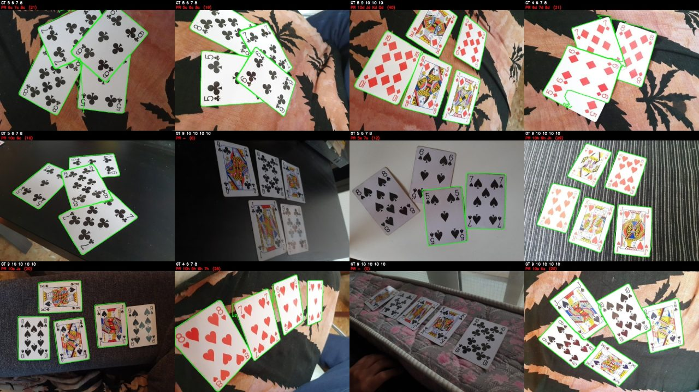
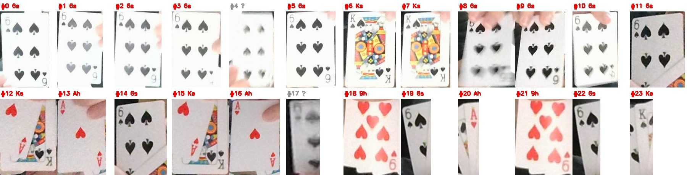

<div align="center">

# 🃏 Poker Card Detection with YOLO

**用 YOLO 即時辨識鏡頭前的撲克牌 —— 從合成資料訓練到真牌實測的完整學習紀錄**

[](https://www.python.org/)
[](https://github.com/ultralytics/ultralytics)
[](https://pytorch.org/)
[](https://fastapi.tiangolo.com/)
[](https://www.kaggle.com/)
[](LICENSE)

[功能](#-功能) · [快速開始](#-快速開始) · [運作原理](#-運作原理) · [結果](#-結果) · [訓練](#-自己訓練模型) · [Roadmap](#-roadmap)



<sub>外部多張實拍資料集上的整張牌分割（綠框）與牌值預測。圖片來源：Roboflow <a href="https://universe.roboflow.com/jallchin/blackjack-cards">jallchin/blackjack-cards</a>（CC BY 4.0）</sub>

</div>

---

## 📖 簡介

這是一個以**學習 YOLO** 為主的個人專案：用 Kaggle 免費 GPU 微調 Ultralytics YOLO，
在本機（RTX 3050 Ti 4GB）用網頁測試台拿**真牌對鏡頭**即時辨識 52 種牌。

過程從單純的牌角物件偵測出發，一路碰到合成資料到真實畫面的落差（sim-to-real gap），
陸續嘗試了多尺度集成、兩階段分類、實例分割、牌內切片與跨幀追蹤投票，最後收斂成目前的「整張牌分割 → 轉正 → 牌角分類」路線。

## ✨ 功能

- 🎯 **整張牌實例分割**：YOLO26n-seg 切出每張牌露出的區域，重疊、旋轉、扇形手牌都能處理
- 🔄 **透視轉正＋牌角分類**：依旋轉框轉正牌面，裁左上／右下牌角給 YOLO26s-cls 判斷牌值（52 類＋none）
- 🔍 **牌內切片**：沿轉正牌面四邊掃描，找出疊在後方、只露出牌角的牌
- 🧹 **背景過濾**：以白邊、彩色比例等與分類器無關的外觀特徵，剔除海報、書櫃等誤判
- 🎞️ **跨幀追蹤投票**：依位置配對、信心加權並隨時間衰減，讓畫面上的牌值穩定不跳動
- 🖥️ **網頁測試台**：攝影機／圖片／重播模式、錄製連續影格、一鍵回測與誤判回報
- 🧪 **合成資料產生器**：把單張牌照片以扇形／散放／疊牌貼到紋理背景，自動產生分割標註

<div align="center">

<br><sub>回測工具輸出的轉正牌面總覽，每張標上預測牌值（灰色 ? 為信心不足、不顯示）</sub>
</div>

## 🚀 快速開始

### 1. 安裝

需要 Python 3.12、[uv](https://github.com/astral-sh/uv) 與 NVIDIA GPU（CPU 也能跑但較慢）。以下為 Windows 路徑：

```bash
git clone https://github.com/yun193/poker-card-detection-yolo.git
cd poker-card-detection-yolo

uv venv .venv --python 3.12
uv pip install --python .venv/Scripts/python.exe torch torchvision --index-url https://download.pytorch.org/whl/cu128
uv pip install --python .venv/Scripts/python.exe -r requirements.txt
```

### 2. 下載模型權重

到 [Releases](https://github.com/yun193/poker-card-detection-yolo/releases) 下載權重，放到 `models.yaml` 指定的路徑
（`<名稱>_best.pt` → `models/<名稱>/best.pt`）。測試台需要 `card_seg` 與 `value_cls` 兩個模型。

```bash
gh release download v1.0 --repo yun193/poker-card-detection-yolo --dir models/_dl
```

### 3. 啟動網頁測試台

```bash
.venv/Scripts/python.exe -m uvicorn web.server:app --port 8765
```

用 Chrome 開 <http://localhost:8765> 並允許攝影機。啟動時會先預熱模型（約 10～15 秒）。

### 4. 執行測試

```bash
.venv/Scripts/python.exe -m pytest -q
```

## 🧠 運作原理

```
攝影機畫面
  └─ YOLO26n-seg 整張牌分割（card_seg）
       └─ 旋轉框透視轉正 ──► 裁左上／右下牌角 ──► YOLO26s-cls 牌值分類（value_cls，52 類＋none）
            ├─ 背景過濾：四周白邊、幾乎沒有紅以外的彩色、至少一角不是 none
            ├─ 牌內切片：沿轉正牌面四邊掃描，找疊在後面那張牌的牌角
            └─ 跨幀追蹤投票：依位置配對，信心加權、隨時間衰減；附加牌值要連續出現才列出
```

<details>
<summary><b>為什麼不直接偵測牌角？（演進歷程）</b></summary>

| 階段 | 做法 | 學到的事 |
|---|---|---|
| v1 牌角偵測 | YOLOv8n 偵測牌角索引（點數＋花色），合成測試 mAP50 0.995 | 資料集標的是**牌角**不是整張牌，一張牌會偵測到兩個對角，要後處理合併 |
| v2 兩階段＋集成 | 多尺度集成（416＋832 投票）＋從高解析原圖裁角給 YOLOv8s-cls 二次分類 | 合成指標近乎滿分，真牌遠距、模糊、扇形重疊時大量掉分 |
| v3 整張牌路線 | YOLOv8n-seg 分割整張牌 → 轉正 → 裁角分類；牌內切片＋追蹤投票 | 主牌值準確度與牌角路線相同，但錯誤的附加牌值大幅減少 |
| v4 YOLO26＋真牌微調 | 換成 YOLO26，用手動標註的真牌錄影微調 | 真牌微調是讓分割在實拍畫面上可用的關鍵 |

**切片推論的取捨**：畫面只有 1280×720、牌寬中位約 62px，整圖切片（SAHI 式）對整張牌沒幫助、對牌角路線耗時 6 倍只多一點召回；
所以改在**轉正後的牌內**沿四邊切片。

早期的牌角路線封存在 [`_archive/corner_route_v2/`](_archive/corner_route_v2/)，最早的 21 點提示版在 [`_archive/blackjack_v1/`](_archive/blackjack_v1/)。

</details>

## 📊 結果

### 合成驗證集

| 模型 | 任務 | 指標 |
|---|---|---|
| YOLO26n-seg | 整張牌分割 | mask mAP50-95 **0.945** |
| YOLO26s-cls | 轉正牌角牌值分類 | top-1 **0.907**／top-5 0.970 |
| YOLOv8n-seg | 整張牌分割（前一版） | mask mAP50-95 0.945 |
| YOLOv8n | 牌角偵測（已封存） | mAP50 0.995／mAP50-95 0.913 |

### 真實畫面

| 測試資料 | 內容 | 精確率 | 召回率 |
|---|---|---|---|
| 自家錄影 | 手持真牌對 webcam，含扇形疊牌 | 85.9% | 57.4% |
| [jallchin/blackjack-cards](https://universe.roboflow.com/jallchin/blackjack-cards) | 848 張手機實拍，4～6 張牌散放桌面（以點數比對） | ~90% | 42.7% |
| [gunhcolab 52-card deck](https://www.kaggle.com/datasets/gunhcolab/object-detection-dataset-standard-52card-deck) | 618 張網路圖庫單張牌特寫 | ~90% | 45.8% |

> **最大的教訓**：合成資料上的進步不會自動轉移到真實畫面。精確率已經不錯（認出來的大多是對的），
> 目前最大的弱點是**召回率** —— 多張牌緊密重疊時分割容易把相鄰牌併成一個，或切到牌但讀不出牌角。

## 🗂️ 專案結構

```
├── blackjack_vision/    核心推論：模型包裝、轉正裁角、牌內切片、背景過濾、追蹤投票
├── web/                 FastAPI 伺服器＋網頁測試台
├── kaggle/              Kaggle 訓練腳本、notebook 與合成資料產生器
├── tests/               pytest 單元與 API 測試
├── docs/assets/         README 圖片
├── _archive/            封存的舊路線（21 點提示版、牌角路線）
├── backtest_real.py     實拍影格回測（完整流程重播＋轉正牌面總覽）
├── eval_voc.py          外部 VOC／Roboflow 資料集評估
├── eval_recording.py    錄影手動標註驗收
└── models.yaml          本機模型登錄表
```

> 套件名稱 `blackjack_vision` 沿用自最早的 21 點提示版本。

## 🖥️ 網頁測試台

| 功能 | 說明 |
|---|---|
| 攝影機／圖片／重播 | 已確認的牌依追蹤編號配色、標牌值與信心；被背景過濾剔除的框為灰色虛線 |
| 手牌面板 | 大字顯示已確認的手牌，逐框列出牌值、信心、穩定度；沒有牌值時說明原因 |
| 除錯資訊 `D` | 畫出牌角位置、牌內切片命中點、追蹤編號與外觀特徵數值 |
| 錄製 `R` | 連續存下每一幀到 `data/recordings/`（上限 60 秒），可重播或回測 |
| 回報誤判 `E`／存測試照 `S` | 存到 `data/hard_cases/`、`data/real_test/`，可一鍵逐張評估 |

> ⚠️ `data/` 內的錄影與測試照可能拍到人臉，已列入 `.gitignore`，不會被提交。

### 實拍影格回測

換模型或改流程後，用同一批影格依原始時間戳重跑完整流程：

```bash
.venv/Scripts/python.exe backtest_real.py --folders "data/recordings/*"
.venv/Scripts/python.exe backtest_real.py --seg models/card_seg/best.pt --no-scan
```

輸出到 `reports/backtest_*/`：`summary.md`（框數、單／多／無牌值、手牌變動次數、每幀耗時）與轉正牌面總覽圖。

## 🏋️ 自己訓練模型

用 `kaggle/` 的 notebook：Kaggle → Import Notebook → 開 GPU 與 Internet → Save & Run All，跑完把輸出解壓到 `models/<名稱>/`。

| Notebook | 輸出 | 資料集 |
|---|---|---|
| `train_card_seg.ipynb` | 整張牌分割（合成資料） | [Cards Image Dataset](https://www.kaggle.com/datasets/gpiosenka/cards-image-datasetclassification)、[DTD](https://www.kaggle.com/datasets/jmexpert/describable-textures-dataset-dtd) |
| `train_value_cls.ipynb` | 牌角牌值分類（合成資料） | 同上 |
| `train_seg_ft.ipynb` | 分割真牌微調 | 手動標註的錄影影格 |
| `train_value_ft.ipynb` | 分類真牌微調 | 錄影裁出的真牌牌角＋合成資料 |
| `train_ultralytics.ipynb`／`train_corner_cls.ipynb` | 牌角偵測／二次分類（封存路線） | [Playing Cards Object Detection](https://www.kaggle.com/datasets/andy8744/playing-cards-object-detection-dataset)（CC0） |

修改 `.py` 後執行 `python kaggle/build_notebooks.py` 重新產生 `.ipynb`。

## 🛣️ Roadmap

- [x] 牌角偵測＋二次分類（v1／v2）
- [x] 整張牌分割＋轉正牌角分類（v3）
- [x] 牌內切片、背景過濾、跨幀追蹤投票
- [x] 改用 YOLO26 並以真牌微調（v4）
- [x] 外部真牌資料集評估
- [ ] value_cls 的 none 類加入牌中央大花色與背景裁圖，降低誤讀
- [ ] 改善緊密疊牌的分割（提升召回率）
- [ ] 依 YOLO26 分類器重新調整牌值顯示門檻

## 🙏 致謝

- [Ultralytics](https://github.com/ultralytics/ultralytics) — YOLOv8／YOLO26
- [andy8744/playing-cards-object-detection-dataset](https://www.kaggle.com/datasets/andy8744/playing-cards-object-detection-dataset)（CC0）
- [gpiosenka/cards-image-datasetclassification](https://www.kaggle.com/datasets/gpiosenka/cards-image-datasetclassification)
- [Describable Textures Dataset (DTD)](https://www.robots.ox.ac.uk/~vgg/data/dtd/)
- [jallchin/blackjack-cards](https://universe.roboflow.com/jallchin/blackjack-cards)（CC BY 4.0）、[gunhcolab 52-card deck](https://www.kaggle.com/datasets/gunhcolab/object-detection-dataset-standard-52card-deck) — 外部評估

## 📄 License

程式碼以 [MIT](LICENSE) 授權；各資料集依其原始授權。
